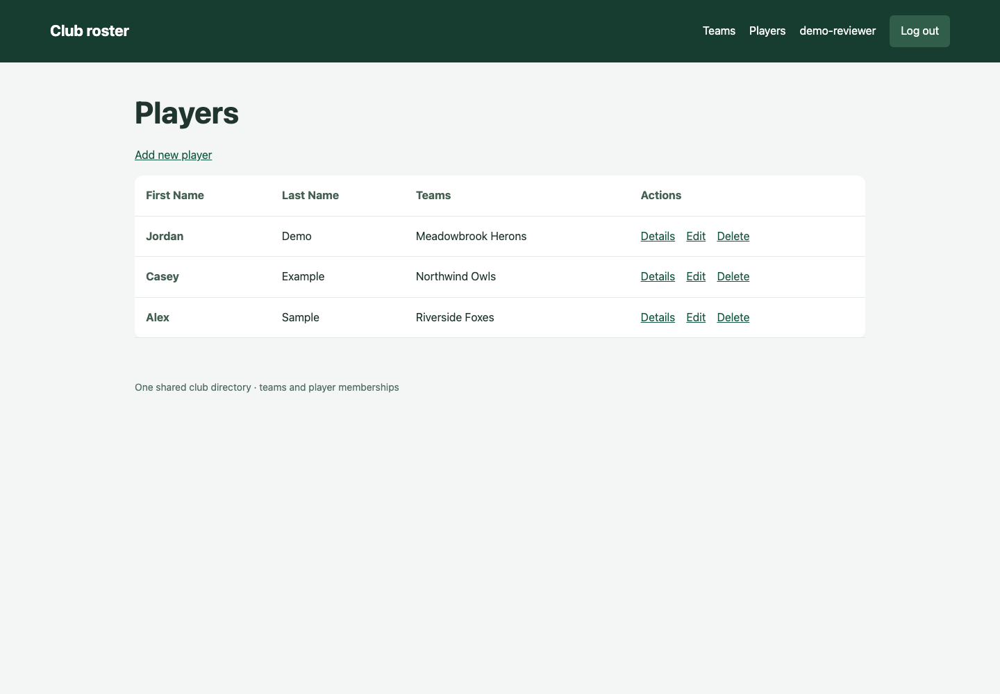
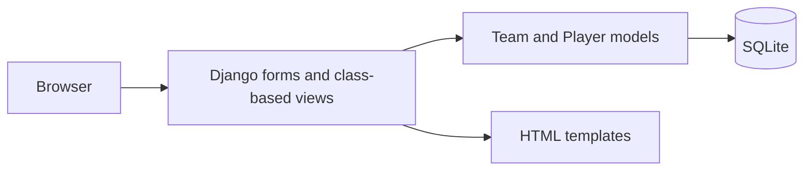

# Club roster

A Django application for keeping a shared directory of teams and players. Register an account, create teams, add players and assign each player to one or more teams. Despite the repository's `-api` name, the implemented interface is server-rendered HTML, not a REST or GraphQL API.



The screenshot shows the actual Django-rendered player view with synthetic data in an isolated in-memory database. It is a desktop presentation check, not an end-to-end browser test.

## Try the workflow

Use Python 3.9+ in an isolated environment. Requirements retain the original Django 4.2 pin; this review did not migrate the framework.

```sh
git clone https://github.com/dev-nezuko/athletics-league-api.git
cd athletics-league-api
python -m venv .venv
source .venv/bin/activate
python -m pip install -r requirements.txt
python manage.py migrate
python manage.py runserver
```

Open [the application](http://127.0.0.1:8000/), choose **Create account**, then add a team and a player. Team details show its roster; player details show all team memberships. No seed user, password or sample data is installed automatically.

For the container workflow:

```sh
cp .env.example .env
docker compose up --build
```

Compose runs migrations before starting Django, mounts the source at the image's actual `/app` directory and binds port 8000 to loopback. SQLite data lives in the ignored local `db.sqlite3` file. For direct Python runs, export settings in your shell; Django does not automatically load `.env`.

## How it fits together



| Area | Implementation |
| --- | --- |
| `sports/models.py` | Team, Player and their many-to-many memberships |
| `sports/forms.py` | Model-backed create and edit forms |
| `sports/views.py` | Login-protected CRUD, account signup and POST logout |
| `templates/sports/` | Lists, details, forms and error pages |
| `sports/tests.py` | Membership rendering, access checks, CSRF logout, errors and query regression |

`/team/` and `/player/` are the main lists. Player lists prefetch team memberships to avoid an extra query for every row. Logout uses a CSRF-protected POST; delete confirmation pages also require POST to remove an object.

## Local configuration and limits

Debug mode defaults on for local use and generates an ephemeral signing key unless `DJANGO_SECRET_KEY` is set. Set a private key before `DJANGO_DEBUG=0`; configure `DJANGO_ALLOWED_HOSTS` for a deliberate deployment. If a historical signing key was used in a deployment, rotate it there too. Removing a value from Git does not revoke existing credentials or clear other people's copies.

All registered users share the same directory and can edit it. There are no per-club ownership rules, invitation controls or role-based permissions. Public signup is enabled. Treat this as a small local CRUD example until those rules and a deployment configuration are added. Large directories would also need pagination and search.

Unused copied fonts were removed; the current UI uses system fonts and requires no CDN assets. No license file is present, so this README does not grant reuse rights.

## Verification

```sh
python manage.py test sports
```

Eight focused tests cover anonymous redirects, player and team detail rendering, POST-only CSRF-protected logout, correct 404/500 statuses, and prefetched memberships. They passed using Django 4.2 in the isolated verification environment. Docker Compose configuration was parsed; the Docker image itself was not built or run.
