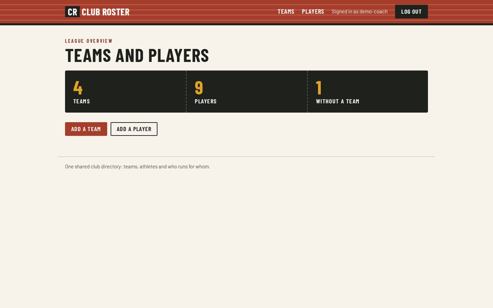
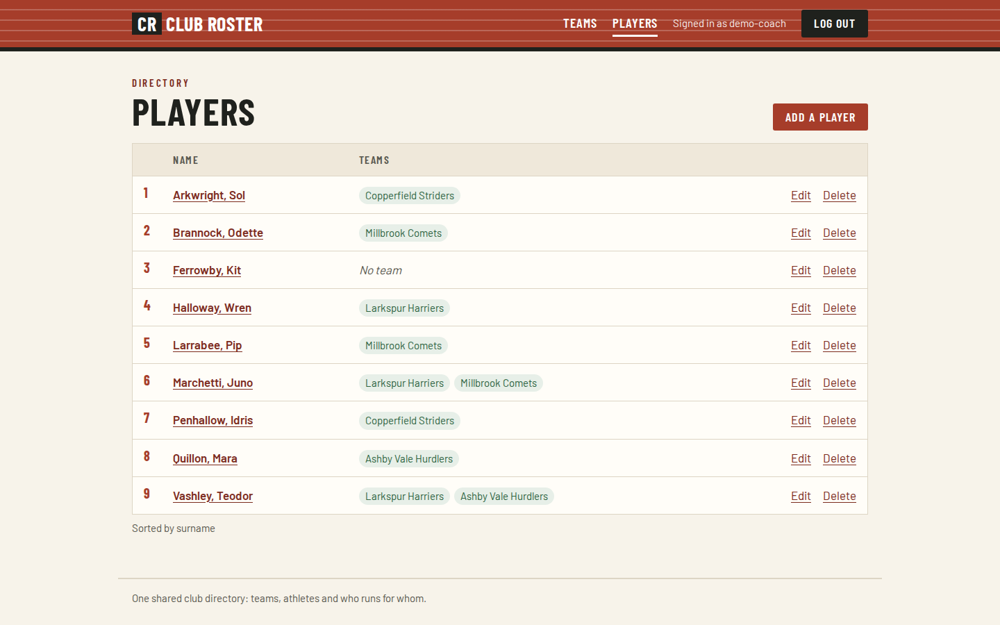
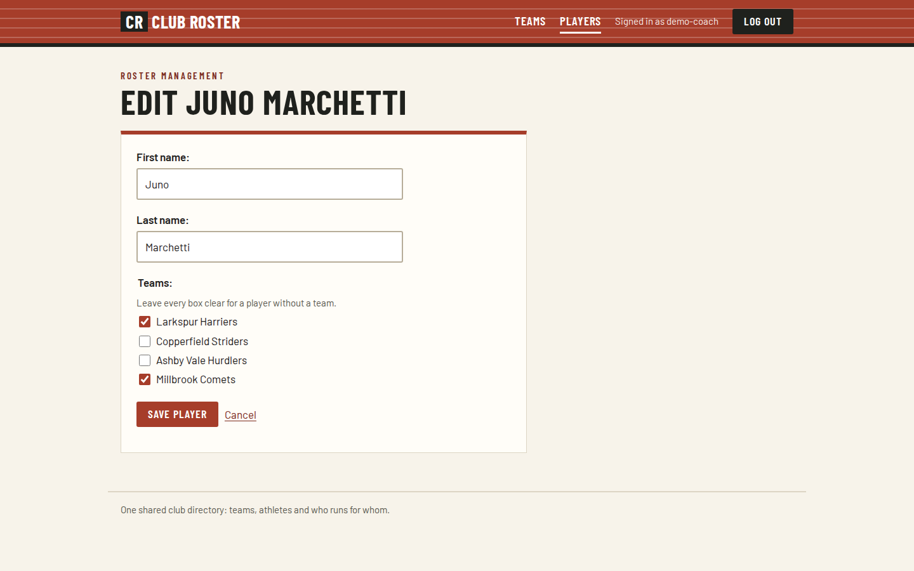
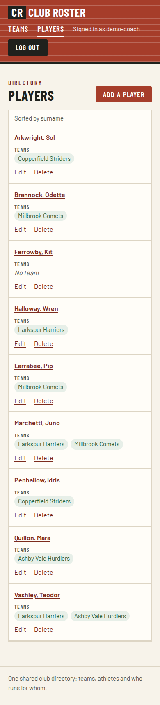
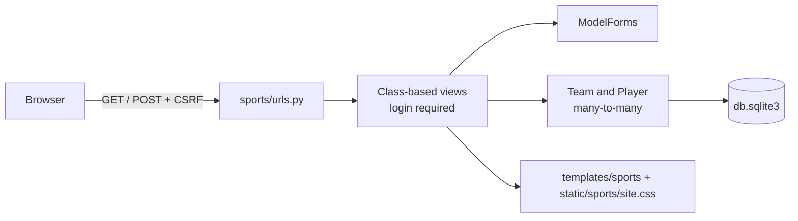

# Club roster

A small Django app for keeping one shared directory of an athletics league's teams and the players who run for them. Signed-in users create teams, add players, and assign each player to any number of teams, including none. Despite the `-api` in the folder name, the interface is server-rendered HTML; there is no REST or GraphQL endpoint.



## What it does

- **Teams:** city and mascot, with a detail page listing the roster sorted by surname.
- **Players:** first and last name, plus team memberships picked from labelled checkboxes. A player with no team is shown as such rather than rejected.
- **Overview:** live counts of teams, players and players without a team.
- **Accounts:** sign-up, log in, and log out by CSRF-protected POST. Every directory page requires a login.
- **Feedback:** a confirmation message after each save or delete, an error summary on invalid forms, and empty states with a next step.



| Editing a player | Phone layout |
| --- | --- |
|  |  |

All names in the screenshots come from `seed_demo` and are invented.

## Run it with Docker Compose

```sh
cp .env.example .env
docker compose up --build
```

In a second terminal, load the demo league and create yourself an account:

```sh
docker compose exec web python manage.py seed_demo
```

Open http://127.0.0.1:8000/, choose **Create account**, and log in. Compose applies migrations on start, mounts the source into `/app` so template and code edits reload, and binds port 8000 to loopback only. The SQLite file `db.sqlite3` is written into the project folder and ignored by Git. The container runs as an unprivileged user (uid 1000).

## Run it with Python

The runtime is pinned to Python 3.12 (`.python-version`).

```sh
python3.12 -m venv .venv
source .venv/bin/activate
python -m pip install -r requirements-dev.txt
python manage.py migrate
python manage.py seed_demo
python manage.py runserver
```

Django does not read `.env` by itself; export the variables in your shell if you need values other than the defaults.

| Variable | Default | Purpose |
| --- | --- | --- |
| `DJANGO_DEBUG` | `1` | `0` turns debug off and then requires a secret key |
| `DJANGO_SECRET_KEY` | random per start when debugging | Signing key. Set a private value for anything shared |
| `DJANGO_ALLOWED_HOSTS` | `localhost,127.0.0.1,[::1]` | Comma-separated host names |

## How it fits together



| Path | Role |
| --- | --- |
| `sports/models.py` | `Team`, `Player` and the optional many-to-many membership |
| `sports/views.py` | CRUD views, overview counts, sign-up and sign-in, POST logout, 404/500 handlers |
| `sports/forms.py` | Model forms; team membership uses checkboxes |
| `sports/management/commands/seed_demo.py` | Idempotent fictional league: 4 clubs, 9 athletes, one without a team |
| `templates/sports/` | Pages, shared form-error summary and pagination |
| `sports/static/sports/site.css` | The whole visual design |

## Design notes

- **Queries stay flat.** The player list prefetches memberships, so a page costs two queries however many players it shows. A test pins that count. Both lists page at 25 rows.
- **One template block.** Every page renders through a single `content` block. Access control lives in the views, not in template conditionals. An earlier version hid the login form from signed-in users and left them on a blank page.
- **Look and feel.** The design borrows from a running track: clay-red header with lane lines, a scoreboard-style overview, and condensed Barlow headings over Barlow body text (Google Fonts, with system fallbacks). Every text colour pair meets WCAG AA contrast. The pages include a skip link, visible focus rings, `aria-current` navigation and a fieldset with a legend for team choices. On narrow screens, tables collapse into labelled rows.
- **Admin.** Teams and players are registered in `/admin/` with search, for anyone who creates a superuser with `python manage.py createsuperuser`.

## Tests and lint

```sh
python manage.py test sports   # 26 tests
flake8                         # settings in setup.cfg; migrations excluded
```

The tests cover login redirects, sign-up and sign-in behaviour for signed-in users, the CRUD flows, flash messages, form error markup, pagination, roster ordering, the query count, the 404/500 pages and the seed command.

## Limits

All registered users share and can edit the same directory. There are no per-club permissions, and public sign-up is open. Static files are served by Django's development server only, so a deployment with `DJANGO_DEBUG=0` needs a static-file server (for example `collectstatic` behind a web server). The app has no deployment configuration beyond this. Treat it as a local tool.

## License

MIT; see [LICENSE](LICENSE).
